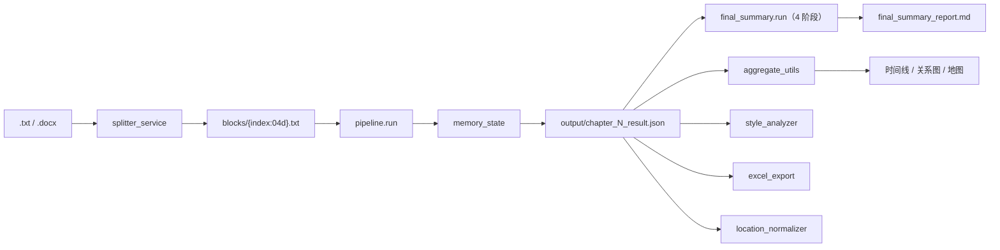
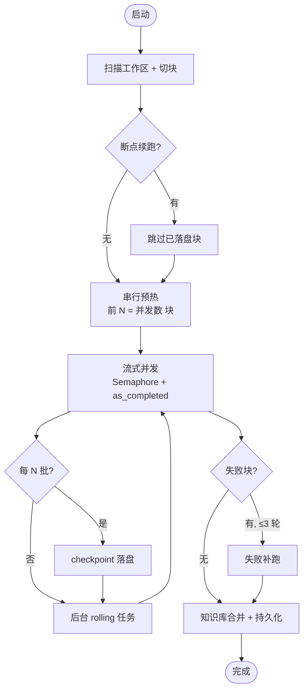

# 架构与实现

本文说明 Novel Analyzer 的系统结构与各子系统的职责边界。日常使用看根目录
[README](../README.md)；接口清单看 [api.md](./api.md)；配置项看
[configuration.md](./configuration.md)。

## 目录结构

```
├── desktop.py                    # pywebview 桌面入口（本地运行时副本 + NOVEL_ROOT 双目录）
├── backend/
│   ├── app.py                    # FastAPI 应用工厂（路由挂载 / 静态托管 / 日志 / 健康检查）
│   ├── main.py                   # 后端启动器
│   ├── ws_events.py              # WebSocket 消息协议的唯一权威定义
│   ├── progress_hub.py           # WebSocket 广播中枢（节流 + 慢消费者驱逐）
│   ├── api/                      # 12 个路由模块 + auth.py + ws.py
│   ├── core/                     # 18 个模块：分析引擎、LLM 客户端、知识库、流水线等
│   ├── services/                 # 15 个模块：编排层（队列、总结、风格、切分、可视化…）
│   ├── vnext/                    # 25 个模块：vnext 数据空间（独立于 1.x 数据层）
│   ├── config/                   # constants.py（默认值与常量）/ settings.py（dataclass）/ presets.py
│   ├── models/                   # AnalysisResult / KnowledgeBase
│   ├── utils/                    # JSON 解析、聚合、Excel、角色卡、账本、文本工具
│   └── tests/                    # 129 个测试文件
├── frontend/
│   └── src/
│       ├── pages/                # 14 个页面
│       ├── components/           # 12 个组件
│       ├── composables/          # 4 个组合式函数
│       ├── api/                  # client.ts（63 个方法）/ sessionToken.ts / useProgressSocket.ts
│       ├── utils/                # 8 个工具模块
│       └── router.ts
├── scripts/                      # 测试与测量脚本
├── config.json                   # 运行配置（密钥不入库）
├── queue_state.json              # 队列状态持久化
└── desktop.spec / build_exe.bat  # PyInstaller 打包
```

## 两套数据空间

项目里同时存在两套数据模型，互不引用：

- **1.x 数据层**：`workspace/{书名}/` 下的 `blocks/` + `output/`，由 `backend/core` 与
  `backend/services` 读写。分析流水线、最终总结、风格分析、可视化都跑在这套上。
- **vnext 数据空间**：`workspace_vnext/{book_id}/` 下的 `source/`、`blocks/`、
  `results/`、`ledger/`、`derived/`、`cache/`，由 `backend/vnext` 读写。
  `backend/vnext/__init__.py` 明确禁止反向 import 旧数据层。

vnext 的语义契约见 [data-contract-vnext.md](./data-contract-vnext.md)。

## 数据流全景



## 章节分析流水线（`backend/core/pipeline.py`）



1. **切块**：按实际存在的章号切块，容错断号目录，块大小由 `analysis.block_size` 决定。
2. **串行预热**：前 N = 并发数 块顺序分析，先建立初始知识库，保证后面的块读不到未来章节。
3. **流式并发**：`asyncio.Semaphore` 限流 + `asyncio.as_completed` 并发，每 N 批 checkpoint 落盘。
4. **失败补跑**：最多 3 轮串行重试；致命错误类（认证、计费、上下文超限、参数错）不重试。
5. **滚动总结**：后台独立任务，跨阈值触发，增量更新四层 JSON（时间轴 / 范式层 / 里程碑 /
   因果链）与近期势头。里程碑 FIFO 淘汰但锁定首条与每个范式层首条；近期势头满窗时
   触发 LLM 归档压缩。

## LLM 客户端（`backend/core/llm_client.py`）

### 单一入口，三方竞争

| 竞争方 | 描述 |
|---|---|
| API 请求 | 主路径，等待模型响应 |
| 用户停止 | 桌面端"停止"按钮立即取消 |
| 硬超时 | SDK timeout + 30 秒兜底 |

任意一方先到，其余立即取消。

### 两级重试链

- **温度退火**：`temp = max(0, temperature − 尝试次 × temperature_step)`，默认
  `temperature=0.1`、`temperature_step=0.05`、最多 `temperature_max_retries=3` 轮，
  实际温度依次为 0.1 / 0.05 / 0。
- **指数退避**：`backoff_max_retries=1`；最后一次错误判定为限流（429）时至少退避 3 轮，
  等待 `min(2^(n+1), 60)` 秒，429 时改为 `min(Retry-After 或 30×(n+1), 120)` 秒。

### 错误判定

重试决策由 `backend/core/error_taxonomy.py` 统一给出，判定结果随调用结果对象一路传到
分析流水线。

- 只有**可信通道**（SDK 异常属性、错误 envelope、真实 HTTP 状态码）有资格判定
  "永久停止"；文本通道的判定上限是可重试。正文里的"第 401 章""赚了 1008 块"不会被
  误判成认证或计费错误。
- 认证失败立即终止只对结构化 401 成立；纯文本形态的"认证失败"走有限重试。
- 拿不到 usage 时，结果的 `tokens` 为 `None`、`usage_status=UNKNOWN`，上报载荷里带着
  这个字段，不会把"未知消耗"宣称为零。

### 思考模式双协议

`thinking_mode` 是字典，经 `extra_body` 注入，按厂商协议二选一：

| 协议 | 适用厂商 | payload |
|---|---|---|
| `thinking` | M2.7 / GLM / M3 | `{"thinking": {"type": "disabled"}}` |
| `enable_thinking` | DeepSeek / Qwen | `{"enable_thinking": false}` |

Anthropic 协议只放行 `thinking` 键；响应侧统一剥除 `<think>` 标签与 `reasoning_content`。

设置页的"自动探测"按钮会调 `POST /api/settings/probe-thinking` 探明端点认哪个键。

## JSON 容错解析链（`backend/utils/json_utils.py`）

模型输出先经 `extract_json_from_text`（5 种提取策略）从噪声里取出 JSON 文本，再走
`parse_json_robust` 的降级链。降级链实际 9 步：

1. 直接 `json.loads`（顶层必须是对象）
2. 截到最后一个 `}` 重试
3. 去掉尾部 `//` 注释
4. 漏引号定向修复（最多 2 轮）
5. 全角标点归一（只在字符串外生效）
6. `json5`（单引号、尾逗号、注释、Python 布尔）
7. `ast.literal_eval`
8. `json-repair`
9. 单引号值转双引号的保守替换

全部失败时返回 `(None, 诊断信息)`，由调用方决定是否重试。

## 伏笔系统

### 分类

`backend/config/constants.py` 定义 **50 类**功能分类，分 **7 组**：人物（8）、情节（10）、
冲突（5）、关系细分（3）、设定（8）、主题（6）、题材专用（10）。每类带若干 type 锚点，
schema 版本号随分类表一起管理。`FORESHADOW_CATEGORY_TEXT` 是前端展示用的中文标签表，
只注入名称与描述，锚点不进提示词。

### 双重约束

- **源头约束**：分析提示词内嵌完整分类表，要求 `type` 必须从中选择，禁止自创
- **被动兜底**：旧书的自由式 type 经 per-book `foreshadow_type_map.json`（带 schema 校验）
  映射到 50 类，不消耗 LLM 调用

### 总表流水线

收集 → 分类 → 三维过滤（重要度 / 置信度达到等级阈值，分类在保留集内）→ 语义去重
（关键词倒排 + 相似度）→ 综合排序 → 分层截断（高重要度 500 条 / 中 200 条）。

重要度与置信度阈值是**中文等级字符串**（`高` / `中` / `低`），不是数值。

### 伏笔账本

`foreshadow_ledger.json` 是全书伏笔的状态机，状态分 `active` / `resolved` / `dormant`。
休眠判定：连续 15 批未出现且跨度不少于 200 章。reconciliation 逐批判定回收，
全书复检兜底。

## 最终总结（`backend/services/final_summary.py`）

四个阶段：


| 阶段 | 内容 | 调用量 | 断点 |
|---|---|---|---|
| 1/4 | 每批两次调用：Markdown 卷摘要 + JSON 回收判定 | `ceil(块数 / summary_batch_size)` × 2 | 卷摘要完成即落盘；调和失败只补调和 |
| 2/4 | 全书伏笔复检 | `ceil(活跃伏笔数 / foreshadow_recheck_batch_size)`，受 `recheck_max_calls` 预算约束 | 每批完成立即落盘账本，重启只复检剩余 active |
| 3/4 | 风格分析：统计指标 + LLM 8 维语义 | 1 | 重跑成本低 |
| 4/4 | 汇总成最终报告 | 1 | 单次调用 |

断点目录是 `output/final_summary_checkpoint/`，包含 `volume_{idx}.md`、`recon_{idx}.json`
与 `manifest.json`。

总结可以用独立的模型与思考模式（`summary_model` / `summary_thinking_mode`），空值跟随
全局设置——思考型模型在大提示词上延迟高，换快模型是常见做法。

## 断点续跑

- **章节分析**：每 N 批落盘，重跑跳过已完成块。
- **最终总结**：卷摘要与调和结果独立落盘；中断后只补缺的调和；复检阶段每批落盘账本，
  已回收的伏笔不重复付费。

## vnext 复检链路

vnext 的复检走 `backend/vnext/` 这一组模块，与 1.x 的复检是两套实现：

| 环节 | 模块 | 职责 |
|---|---|---|
| 规划 | `recheck_plan.py` | 复检计划与覆盖汇总 |
| 取材 | `context.py` | 把"全书"换成几段诚实的原文窗口 |
| 证据 | `resolution.py` | 原文证据校验与全自动裁决，把模型答复变成程序可判定的状态 |
| 执行 | `runner.py` | 规划 → 预算 → 裁决 → 账本 → 落盘 |
| 预算 | `budget.py` | 请求前预留、失败按实扣、未开始可退 |
| 熔断 | `breaker.py` | 只有"整个账号都不行"才停止派发 |
| 账本 | `tasks.py` | 可判定、可重放、可复用的任务账本 |

裁决的关键设计：**模型只给原话，位置由程序算**。模型回包里的 `supporting_span` 不是
必需字段，程序用引文去原文定位并写出 `located_span`；引文在原文中找不到或多处命中时，
按既定规则降级为 `INVALID`，而不是让模型自己报坐标。

## WebSocket 进度协议

`/ws/progress` 是唯一的推送通道，消息线格式统一为 `{"type": ..., "payload": {...}}`，
`ping` 心跳不带 payload（服务端 25 秒一次）。协议常量集中在 `backend/ws_events.py`，
是前后端共同的唯一来源；前端镜像定义在 `frontend/src/api/useProgressSocket.ts`。

消息类型 11 种：`log`、`progress`、`block_start`、`block_done`、`discovery`、
`token_stats`、`token_delta`、`state_change`、`summary_progress`、
`location_normalization_progress`、`ping`。
状态机取值 12 种：`idle`、`running`、`stopped`、`done`、`summary_*` 与
`location_normalization_*` 各 4 种。

连接时校验 `Origin`，只允许 localhost / 127.0.0.1（含空 Origin）。

## 桌面端双目录方案

`pywebview` + WebView2 在中文路径、网络盘上有渲染限制。解决方案：

1. 启动时把工程复制到本地运行时副本（`%LOCALAPPDATA%\NovelAnalyzer\runtime\`）
2. 设 `NOVEL_ROOT` 环境变量指回原共享盘，分析结果仍写到原位置
3. WebView2 在本地副本里加载 `dist/`

## 开发模式

```bash
python -m uvicorn backend.app:app --reload --port 8000   # 后端
cd frontend && npm run dev                                 # 前端
```

CORS 放行 `localhost:5173`。

## 新增配置字段

`APIConfig` / `AnalysisConfig` 是 dataclass，加字段即自动读写（`_coerce_fields` 过滤
未知字段并清洗类型，保证旧 `config.json` 兼容）。前端 `AppConfigDto` 必须同步补类型。

## 提示词调整注意

提示词要遵守 KV cache 布局原则：变化频率低的内容（分类表、世界观、主题）放 system
稳定前缀，逐章变化的内容（章节正文、近期势头）放 user 部分。提示词结构一变，远端
缓存就失效。
