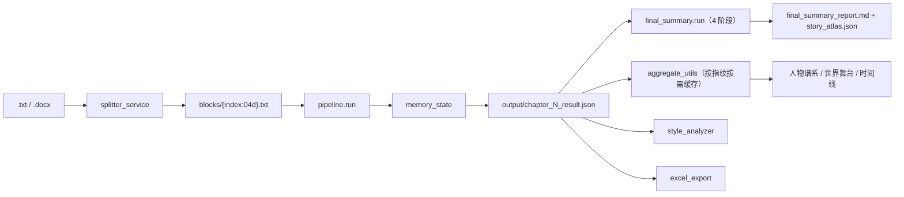
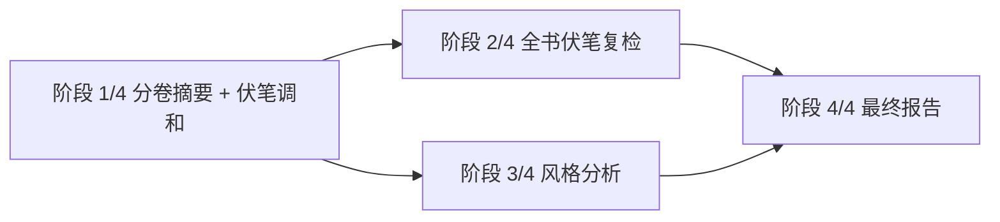

# 架构与实现

本文说明 Novel Analyzer 的系统结构与各子系统的职责边界。日常使用看根目录
[README](../README.md)；接口清单看 [api.md](./api.md)；配置项看
[configuration.md](./configuration.md)。

## 目录结构

```
├── desktop/                      # pywebview 桌面入口、PyInstaller 打包与首次启动模板
├── backend/
│   ├── app.py                    # FastAPI 应用工厂（路由挂载 / SPAStaticFiles 静态托管 / 日志 / 健康检查）
│   ├── main.py                   # 后端启动器
│   ├── ws_events.py              # WebSocket 消息协议的唯一权威定义
│   ├── progress_hub.py           # WebSocket 广播中枢（节流 + 最坏 O(1) FIFO 分级慢消费者驱逐）
│   ├── api/                      # 10 个路由模块 + auth.py + ws.py（业务编排在 services，规则由 test_smoke.py 守护）
│   ├── common/                   # 共用纯逻辑语义层：错误分类（error_types /
│   │                             #   error_taxonomy）、审核标记（moderation）、LLM 错误信号
│   │                             #   （llm_signals）、复检请求日志（recheck_request_log）、
│   │                             #   代理净化（proxy_env）等（10 个模块，只依赖标准库，禁止引用 core/services）
│   ├── core/                     # 核心引擎（23 个模块）：分析流水线、LLM 客户端、知识库、风格提取等
│   │                             #   （error_types / error_taxonomy / moderation 是 common 的兼容转发层）
│   ├── services/                 # 15 个单文件模块 + final_summary/ 四层无环子包（8 个内部模块） + recheck_v3/ 四层无环子包（6 个内部模块）：编排层（队列、总结、切分、可视化、复检与裁决、用量账本…）
│   ├── config/                   # constants.py（默认值与常量）/ paths.py（路径真源）/ settings.py / presets.py
│   ├── models/                   # AnalysisResult / KnowledgeBase
│   ├── utils/                    # JSON 解析、按需聚合缓存、Excel、角色卡、账本、文本工具
│   └── tests/                    # 14 个领域测试文件 + conftest / pytest_isolation / pytest_ssl_cache + fixtures 语料
├── frontend/
│   └── src/
│       ├── pages/                # 9 个主页面（旧入口保留带参重定向）
│       ├── components/           # 14 个通用组件 + settings/（4 个配置卡片组件）
│       ├── composables/          # 5 个组合式函数（含 useSelectedBook）
│       ├── api/                  # client.ts / sessionToken.ts / useProgressSocket.ts
│       ├── utils/                # 10 个工具模块（含 settingsTooltips.ts）
│       └── router.ts
├── scripts/                      # 测试、打捞验收与基线测量脚本
└── runtime/                      # 源码模式统一运行目录（.gitignore 忽略：config.json / queue_state.json / usage_state.json / workspace/ / logs）
```

## 数据流全景



## 章节分析流水线（`backend/core/pipeline.py`）


1. **切块**：按实际存在的章号切块，容错断号目录，块大小由 `analysis.block_size` 决定。
2. **串行预热**：前 N = 并发数 块顺序分析，先建立初始知识库，保证后面的块读不到未来章节。
3. **流式并发**：`asyncio.Semaphore` 限流 + `asyncio.as_completed` 并发，每 N 批 checkpoint 落盘；`MemoryState` 与 `KnowledgeBaseManager` 统一按 `kb_limits` 裁剪 7 个列表与 2 个角色字典（通过尾部热键重插与单调章号水位线防止乱序历史块覆写高章号状态）。
4. **失败补跑**：最多 3 轮串行重试；致命错误类（认证、计费、上下文超限、参数错）不重试，账户级熔断触发后立即停止流水线，队列层（`queue_service.py`）保留当前书目 `pending` 并附脱敏错误理由、暂停后续队列与自动总结。
5. **滚动总结**：后台独立任务，跨阈值触发，增量更新四层 JSON（时间轴 / 范式层 / 里程碑 /
   因果链）与近期势头；历史补跑批附带防倒退提示词约束且同步受账户级熔断守卫。里程碑 FIFO 淘汰但锁定首条与每个范式层首条；近期势头满窗时触发 LLM 归档压缩。

## LLM 客户端（`backend/core/llm_client.py`）

### 单一入口，三方竞争

| 竞争方 | 描述 |
|---|---|
| API 请求 | 主路径，等待模型响应 |
| 用户停止 | 桌面端"停止"按钮立即取消 |
| 硬超时 | SDK timeout + 30 秒兜底 |

任意一方先到，其余立即取消。

### 两级重试链

- **温度退火**：`temp = max(0, temperature − 尝试次 × temperature_step)`，默认
  `temperature=0.1`、`temperature_step=0.05`、最多 `temperature_max_retries=3` 轮，
  实际温度依次为 0.1 / 0.05 / 0。
- **指数退避**：`backoff_max_retries=1`；最后一次错误判定为限流（429）时至少退避 3 轮，
  等待 `min(2^(n+1), 60)` 秒，429 时改为 `min(Retry-After 或 30×(n+1), 120)` 秒。

### 错误判定

重试决策由 `backend/core/error_taxonomy.py` 统一给出，判定结果随调用结果对象一路传到
分析流水线。

- 只有**可信通道**（SDK 异常属性、错误 envelope、真实 HTTP 状态码）有资格判定
  "永久停止"；文本通道的判定上限是可重试。正文里的"第 401 章""赚了 1008 块"不会被
  误判成认证或计费错误。
- 认证失败立即终止只对结构化 401 成立；纯文本形态的"认证失败"走有限重试。
- 拿不到 usage 时，结果的 `tokens` 为 `None`、`usage_status=UNKNOWN`，上报载荷里带着
  这个字段，不会把"未知消耗"宣称为零。

### 思考模式双协议

`thinking_mode` 是字典，经 `extra_body` 注入，按厂商协议二选一：

| 协议 | 适用厂商 | payload |
|---|---|---|
| `thinking` | M2.7 / GLM / M3 | `{"thinking": {"type": "disabled"}}` |
| `enable_thinking` | DeepSeek / Qwen | `{"enable_thinking": false}` |

Anthropic 协议只放行 `thinking` 键；响应侧统一剥除 `<think>` 标签与 `reasoning_content`。

设置页的"自动探测"按钮会调 `POST /api/settings/probe-thinking` 探明端点认哪个键。

## JSON 容错解析链（`backend/utils/json_utils.py`）

模型输出先经 `extract_json_from_text`（5 种提取策略）从噪声里取出 JSON 文本，再走
`parse_json_robust` 的降级链。降级链实际 9 步：

1. 直接 `json.loads`（顶层必须是对象）
2. 截到最后一个 `}` 重试
3. 去掉尾部 `//` 注释
4. 漏引号定向修复（最多 2 轮）
5. 全角标点归一（只在字符串外生效）
6. `json5`（单引号、尾逗号、注释、Python 布尔）
7. `ast.literal_eval`
8. `json-repair`
9. 单引号值转双引号的保守替换

全部失败时返回 `(None, 诊断信息)`，由调用方决定是否重试。

## 伏笔系统

### 分类

`backend/config/constants.py` 定义 **50 类**功能分类，分 **7 组**：人物（8）、情节（10）、
冲突（5）、关系细分（3）、设定（8）、主题（6）、题材专用（10）。每类带若干 type 锚点，
schema 版本号随分类表一起管理。`FORESHADOW_CATEGORY_TEXT` 是前端展示用的中文标签表，
只注入名称与描述，锚点不进提示词。

### 双重约束

- **源头约束**：分析提示词内嵌完整分类表，要求 `type` 必须从中选择，禁止自创
- **被动兜底**：旧书的自由式 type 经 per-book `foreshadow_type_map.json`（带 schema 校验）
  映射到 50 类，不消耗 LLM 调用

### 总表流水线

收集 → 分类 → 三维过滤（重要度 / 置信度达到等级阈值，分类在保留集内）→ 语义去重
（关键词倒排 + 相似度）→ 综合排序 → 分层截断（高重要度 500 条 / 中 200 条）。

重要度与置信度阈值是**中文等级字符串**（`高` / `中` / `低`），不是数值。

### 伏笔账本

`foreshadow_ledger.json` 是全书伏笔的状态机，状态分 `active` / `resolved` / `dormant`。
休眠判定按章距跨度 `DORMANT_CHAPTER_THRESHOLD`（200 章）触发，并跳过 `needs_review=True` 的待确认条目。`reconciliation` 逐批判定回收，全书复检兜底；人工可通过 `POST /api/books/{book_id}/ledger/{item_id}/review` 及前端「时间线 / 伏笔排行」或「最终总结 / 复检明细」页执行 `confirm_resolved` / `reject_to_active` / `mark_dormant` 覆写（写入 `source_type="human_override"` 并清空 `needs_review`），覆写后的条目受自动复检引擎跳过保护。

## 最终总结（`backend/services/final_summary/`）

四个阶段：



| 阶段 | 内容 | 调用量 | 断点 |
|---|---|---|---|
| 1/4 | 每批两次调用：Markdown 卷摘要 + JSON 回收判定 | `ceil(块数 / summary_batch_size)` × 2 | 卷摘要校验通过（拦截拒答与缺正文回复）后落盘，断点加载同步校验；调和失败只补调和；全批完成落 `stage1_ledger_baseline.json` 干净账本基线 |
| 2/4 | 全书伏笔复检 | 默认 V3 共享证据池单阶段引擎（受 `recheck_max_calls` 预算约束）；可选切换 V2 引擎或启用灰区 U4、支线单跳开关 | 完整 `COMPLETED` 落 `stage2_recheck_state.json`（指纹含引擎开关），重跑跳过已核对轮次；中断保留进程内账本 |
| 3/4 | 风格分析：统计指标 + LLM 8 维语义 | 1 | 有效结果落 `style_profile.json`（按正文集合与模型指纹失效） |
| 4/4 | 汇总成最终报告（Markdown 结构化表格 + 内化文风叙事）并并发提取全书语义图谱 `story_atlas.json` | 1 + 2（图谱） | 报告直落盘；图谱按 `char_atlas_fp` / `world_atlas_fp` 双子指纹独立缓存，异常降级不阻塞主报告 |

最终总结实现拆分为 4 层无环子包 `backend/services/final_summary/`：`prompts.py`、`parsers.py` 与 `atlas_extractor.py`（Layer 1 纯常量、解析与图谱清洗函数）→ `catalog_mixin.py`、`checkpoint_mixin.py`、`recheck_mixin.py`（Layer 2 职责内聚 Mixin）→ `runner.py`（Layer 3 `FinalSummaryRunner` 主执行器）→ `__init__.py`（Layer 4 门面导出）。

断点目录是 `output/final_summary_checkpoint/`，包含 `volume_{idx}.md`、`recon_{idx}.json`、`manifest.json`、`stage1_ledger_baseline.json`、`stage2_recheck_state.json`、`style_profile.json` 与 `recheck_v3_u1_cache.json`；详细裁决记录写入 `output/recheck_verdicts.json`。

### 伏笔复检引擎（V3 / V2）

阶段 2/4 由 `recheck_version` 选择带证据复检引擎（`"v3"` 默认 / `"v2"` 可选）：

- **V3 共享证据池多跳引擎（默认，四层无环子包 `backend/services/recheck_v3/`）**：
  - 模块拓扑为 `prompts.py`（Layer 1 静态常量与模板）→ `parsers.py` / `preprocessing.py`（Layer 2 解析与跨题材文本预处理）→ `evidence_pool.py`（Layer 3 共享证据池与证据链核验）→ `runner.py`（Layer 4 主执行器 `run_recheck_v3`），经 `__init__.py` 统一导出；目录级代码快照由 `compute_recheck_code_snapshot()` 跨平台归一化计算。
  - **均衡超块与双向路由（U1）**：按作品篇幅将章节事件摘要均衡切分为受上下文预算约束的超块，批量拆解核心问题与次要支线（`50` 条/批，紧凑模式 `25` 条/批），抽取并合并实体别名词典后执行双向路由。
  - **严格前置门控、共享证据池与跨池继受（U2 / U3 / U5）**：每条伏笔默认选取至多 `5` 个设伏后原文窗口（超长单章自动双窗采样），严格仅在 `needs_pre_setup_backref` 为真时附带 `1` 个设伏前因果回指窗；批内按章节重合度装箱并使用去重【共享正文证据池】执行单阶段核查与终审，保留至多 `3` 跳深挖追踪，支持同池章节跨题继受；确定性校验层核对逐字引文锚点并触发单轮精确修复，且在落账时优先选择设伏后兑现章写入 `resolved_chapter`。
  - **可选审检与省费开关**：`recheck_v3_gray_u4`（默认 `false`）开启后对多跳、非高置信或争议条目追加一轮灰区共享池 U4 终审；`recheck_v3_mid_single_hop`（默认 `false`）开启后中重要度条目在 U2 缩减至 `3` 个后文窗并跳过二三跳（高重要度条目保留全窗多跳）。
  - **四态分层裁决与账本回写**：自动跳过 `source_type == "human_override"` 的人工覆写条目；其余活跃候选判定归类为 `RESOLVED_EXPLICIT`、`RESOLVED_IMPLICIT`、`PARTIALLY_RESOLVED` 或 `UNRESOLVED`（细分 `ATMOSPHERIC_HOOK` 与 `UNFILLED_PIT`）；其中未解条目会清除阶段 1 留下的未证实暂挂标记，确保长期未回收的伏笔能按账本规则正常进入 `dormant`。
  - **无硬编码通用化**：基于语料统计自动识别主角与超高频词作为过滤停用词，支持正篇/番外标签识别与译名间隔号实体分词。
- **V2 批量窗口引擎（可选，`backend/services/recheck_v2.py`）**：同样跳过 `human_override` 条目，基于关键词检索局部原文窗口并按批核对，裁决逻辑由 `backend/services/recheck_resolution.py` 提供。
  - 裁决关键设计：**模型只给原话，位置由程序算**。模型回包里的 `supporting_span` 不是必需字段，程序用引文去原文定位并写出 `located_span`；引文在原文中找不到或多处命中时，按既定规则降级为 `INVALID`，而不是让模型自己报坐标。

总结可以用独立的模型与思考模式（`summary_model` / `summary_thinking_mode`），空值跟随
全局设置——思考型模型在大提示词上延迟高，换快模型是常见做法。

## 断点续跑

- **章节分析**：每 N 批落盘，重跑跳过已完成块。
- **最终总结**：卷摘要与调和结果独立落盘；中断后只补缺的调和；复检阶段每批落盘账本，
  已回收的伏笔不重复付费。

## WebSocket 进度协议

`/ws/progress` 是唯一的推送通道，消息线格式统一为 `{"type": ..., "payload": {...}}`，
`ping` 心跳不带 payload（服务端 25 秒一次）。协议常量集中在 `backend/ws_events.py`，
是前后端共同的唯一来源；前端镜像定义在 `frontend/src/api/useProgressSocket.ts`。

消息类型 10 种：`log`、`progress`、`block_start`、`block_done`、`discovery`、
`token_stats`、`token_delta`、`state_change`、`summary_progress`、`ping`。
状态机取值 8 种：`idle`、`running`、`stopped`、`done` 与 `summary_*` 4 种。

连接时校验 `Origin`，只允许 localhost / 127.0.0.1（含空 Origin）。

## 桌面端双目录方案

`pywebview` + WebView2 在中文路径、网络盘上有渲染限制。解决方案：

1. 启动时将 `backend/` 与 `desktop/desktop.py` 复制到本地运行时副本（`%LOCALAPPDATA%\NovelAnalyzer\app\`）
2. 由启动脚本传入 `NOVEL_ROOT`（指向仓库根加载 `frontend/dist/` 与模板）及 `NOVEL_RUNTIME_DIR`（指向 `runtime/` 存放运行配置、工作区与日志）
3. WebView2 从本地磁盘副本加载后端与界面，分析结果仍写回源码仓库 `runtime/` 目录

## 开发模式

```bash
python -m uvicorn backend.app:app --reload --port 8000   # 后端
cd frontend && npm run dev                                 # 前端
```

CORS 放行 `localhost:5173`。

## 新增配置字段

`APIConfig` / `AnalysisConfig` 是 dataclass，加字段即自动读写（`_coerce_fields` 过滤
未知字段并清洗类型，保证旧 `config.json` 兼容）。前端 `AppConfigDto` 必须同步补类型。

## 提示词调整注意

提示词要遵守 KV cache 布局原则：变化频率低的内容（分类表、世界观、主题）放 system
稳定前缀，逐章变化的内容（章节正文、近期势头）放 user 部分。提示词结构一变，远端
缓存就失效。
