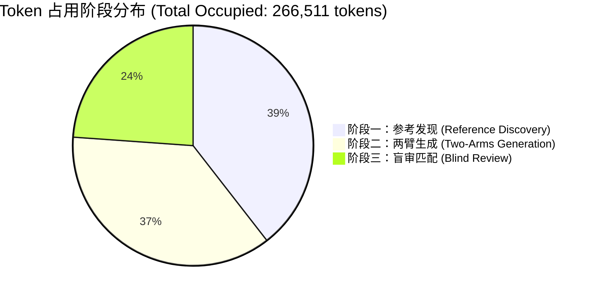
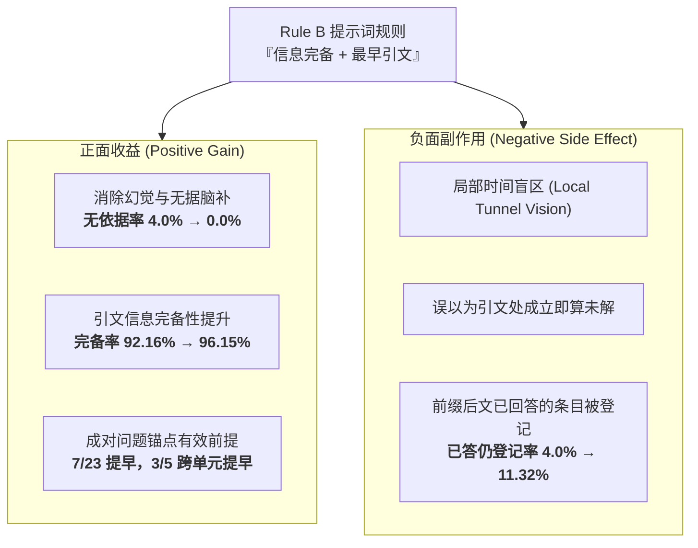

# BC 生产管线收尾：伏笔登记位置规则两臂试跑（Rule A vs Rule B）最终评估报告

- **报告生成时间**：2026-11-08
- **研究范围**：`t4_hist_holdout` 与 `t4_game_holdout` 各 `p1 / p2 / p3` 共 6 个正文前缀
- **试验对象**：
  - **Arm A（对照组 / 现行规则）**：相关摘句规则（取一句能支撑伏笔的原文）
  - **Arm B（候选组 / 完备最早规则）**：在 A 基础上追加「读到所选引文末尾时，提出该问题所需的信息应已齐备；在合格位置中选最早一句」
- **执行阶段**：独立参考发现（Phase 1）→ 两臂确定性生成（Phase 2）→ 去标识化盲审与对齐计算（Phase 3）全量完成

---

## 目录
1. [执行概览与预算台账最终审计](#1-执行概览与预算台账最终审计)
2. [两臂核心质量指标对比](#2-两臂核心质量指标对比)
3. [独立参考集覆盖与遗漏率分析（Loose vs Strict 1-to-1）](#3-独立参考集覆盖与遗漏率分析loose-vs-strict-1-to-1)
4. [引文信息完备性（Anchor Sufficiency）与配对比较](#4-引文信息完备性anchor-sufficiency与配对比较)
5. [独有条目分布与定性案例复盘](#5-独有条目分布与定性案例复盘)
6. [技术与提示词归因分析：Rule B 的双刃剑效应](#6-技术与提示词归因分析rule-b-的双刃剑效应)
7. [生产管线落地建议与后续行动决策](#7-生产管线落地建议与后续行动决策)

---

## 1. 执行概览与预算台账最终审计

依据任务书设定的硬约束（总输入 Token ≤ 336,000，总输出 Token ≤ 84,000，总尝试次数 ≤ 42，单请求上限 20,000），全部三阶段均在预算上限内安全完成，无隐式重试、无并发超额，所有中间产物均完成哈希冻结与内容绑定核验。

### 1.1 预算台账总览

数据源：[`reference-discovery-usage.json`](file:///F:/AI/01_项目/小说分析器/docs/research/bc-production-readiness-2026-11-06/registration-arm-proposal/reference-discovery-usage.json)

| 统计维度 | 设定硬上限 | 实际发生/占用 | 剩余额度 | 使用率 | 状态 |
|---|---|---|---|---|---|
| **调用尝试总次数 (Attempts)** | 42 次 | **34 次** | 8 次 | 80.95% | **合规受控** |
| **占用输入 Token (Occupied Input)** | 336,000 | **232,787** | 103,213 | 69.28% | **安全充裕 (余 30.7%)** |
| **占用输出 Token (Occupied Output)** | 84,000 | **33,724** | 50,276 | 40.15% | **安全充裕 (余 59.9%)** |
| **在途预留 (In-flight Reservations)** | 0 | **0** | 0 | 0.0% | **已全部结算** |
| **用量未知记录 (Unknown Usage)** | - | **1 条** (8,884 tokens) | - | - | **已按上限保全** |

### 1.2 分阶段与分臂消耗分布



| 阶段 / 组别 | 尝试次数 (有效/失败) | 输入 Token | 输出 Token | 说明 |
|---|---|---|---|---|
| **阶段一：参考发现 (Reference)** | 13 次 (12 / 1) | 98,878 | 6,374 | 6 前缀 × 2 独立标注者；Attempt 9 (429) 核销为 0 |
| **阶段二：两臂生成 (Generation)** | 15 次 (12 / 1) | 79,334 | 18,305 | 12 份两臂生成；Attempt 18 超时记 unknown 占用，无隐式重试 |
| **阶段三：盲审匹配 (Blind Review)** | 6 次 (6 / 0) | 54,575 | 9,045 | 6 前缀去标识化确定性打乱盲审，0 失败 |
| **Arm A (对照组生成)** | 8 次 (6 / 1) | 41,717 | 9,424 | 含 Attempt 18 超时占用 |
| **Arm B (候选组生成)** | 7 次 (6 / 0) | 37,617 | 8,881 | 1 次格式轻微残缺即时按规则重试 |

---

## 2. 两臂核心质量指标对比

数据源：[`pilot-metrics-summary.json`](file:///F:/AI/01_项目/小说分析器/docs/research/bc-production-readiness-2026-11-06/registration-arm-proposal/pilot-metrics-summary.json)

指标说明：
- 分母为该臂产出且经盲审裁决为明确标签的有效条目数（有效裁决分母）；不确定项单独剔除并报告裁决覆盖率。
- 宿主跨度唯一定位率分母为系统声称条目数。

| 核心评估指标 | Arm A（现行对照组） | Arm B（候选改进组） | 指标差异 (B - A) | 业务结论与评价 |
|---|---|---|---|---|
| **系统生成伏笔总数** | 51 条 | 53 条 | +2 条 | 产出量级相当，无过度保守收缩 |
| **有效裁决数 / 不确定数** | 50 条 / 1 条 (`i6`) | 53 条 / 0 条 | +3 条 / -1 条 | 盲审争议极低 |
| **有效裁决覆盖率** | 98.04% (50/51) | **100.0%** (53/53) | +1.96% | 裁决完全有效 |
| **无依据率 (`no_ground_rate`)** | **4.00%** (2 / 50) | **0.00%** (0 / 53) | **-4.00%** | **Rule B 彻底消除无依据登记** |
| **已答仍登记率 (`already_answered`)**| **4.00%** (2 / 50) | **11.32%** (6 / 53) | **+7.32%** | **Rule B 出现倒退（关键发现）** |
| **宿主跨度唯一定位率** | **100.0%** (50 / 50) | 98.11% (52 / 53) | -1.89% | B 在 game/p3 有 1 处引文漏首字 |
| **标签分布：有依据** | 46 条 (92.0%) | 47 条 (88.7%) | +1 条 | 绝大多数生成条目事实成立 |
| **标签分布：无依据** | 2 条 (4.0%) | **0 条 (0.0%)** | -2 条 | 完备性约束显著压制无端猜测 |
| **标签分布：已经回答** | 2 条 (4.0%) | 6 条 (11.3%) | +4 条 | 早期引文诱发局部判定偏差 |

---

## 3. 独立参考集覆盖与遗漏率分析（Loose vs Strict 1-to-1）

分母定义：6 个前缀经人工/AI联合裁决、合并等价项后正式冻结的 **28 条独立合格参考伏笔**（`hist/p1: 2, hist/p2: 6, hist/p3: 2, game/p1: 3, game/p2: 7, game/p3: 8`）。

### 3.1 宽松匹配（Loose Matching）与严格 1-to-1 匹配对比

```mermaid
xychart-beta
    title "相对独立参考集遗漏率对比 (Missed Registration Rate)"
    x-axis ["Loose Matching", "Strict 1-to-1 Matching"]
    y-axis "遗漏率 (%)" 0 --> 60
    bar [46.43, 50.00]
    bar [46.43, 48.15]
```


*(注：蓝色为 Arm A，绿色为 Arm B)*

| 匹配模式 | Arm A 命中数 / 遗漏数 | Arm A 遗漏率 | Arm B 命中数 / 遗漏数 | Arm B 遗漏率 | 差异说明 |
|---|---|---|---|---|---|
| **宽松匹配 (Loose)** | 15 命中 / 13 遗漏 | **46.43%** (13/28) | 15 命中 / 13 遗漏 | **46.43%** (13/28) | **两臂对独立参考集的召回覆盖完全相同** |
| **严格 1-to-1 匹配 (Strict)** | 13 命中 / 13 遗漏 (有效参考分母 26) | **50.00%** (13/26) | 14 命中 / 13 遗漏 (有效参考分母 27) | **48.15%** (13/27) | B 略占优势，多重匹配歧义更少 |

- **关键洞察**：
  1. 两臂在宏观参考集覆盖上表现出高度的一致性（宽松遗漏率均为 46.43%），表明追加「信息完备」与「最早引文」规则**并未导致系统产生保守性漏报**。
  2. 遗漏的参考条目主要集中在深层暗线（例如 `game/p3` 的上一任世界树陨落细节、`hist/p2` 的朝局派系隐蔽角力），两臂均未能主动发现，这属于生成器基础语义深度问题，而非两臂规则差异所致。

---

## 4. 引文信息完备性（Anchor Sufficiency）与配对比较

在盲审阶段，评审员对每一条系统生成的伏笔引文独立判定：「仅读到该引文末尾时，提出该问题所需的前提信息是否已齐备（`anchor_sufficient_at_quote`）」。

### 4.1 全量定位条目的引文完备率

| 组别 | 成功定位总数 | 引文处信息完备 (`sufficient`) | 引文处信息不完备 (`insufficient`) | 完备率 |
|---|---|---|---|---|
| **Arm A（对照组）** | 51 条 | 47 条 | 4 条 | 92.16% |
| **Arm B（候选组）** | 52 条 | **50 条** | 2 条 | **96.15%** |

Arm B 的引文信息完备率提升了 3.99 个百分点，表明提示词中「提出该问题所需的信息应已齐备」有效促使模型选择了信息量更充沛的引文切片。

### 4.2 两臂同题配对比较（Paired Same-Question Comparison）

在 104 条生成项中，盲审聚类识别出 **28 组**两臂均提出相同问题的成对样本（Paired Clusters）：

- **同单元内引文位置对比**（共 23 组处于相同正文单元）：
  - **Arm B 引文显著更早**：**7 组**（平均提前 40~350 字符）
  - **两臂选中完全一致位置**：**10 组**
  - **Arm B 引文偏晚**：**6 组**（主要因 B 为满足「信息完备」而多包含了后一句定性说明）
- **跨单元引文位置对比**（共 5 组处于不同单元）：
  - **Arm B 选中了更早的物理单元**：**3 组**（例如 `hist/p3` 中 B 在 Unit 1 即锚定盈歌退婚之策而 A 延至 Unit 2，`game/p3` 中 B 在 Unit 2 即锁定前世蓝星网络连接而 A 延至 Unit 3；另有 `game/p2` 中 `ref:r4` 因过度前移至 `u1[419:445]` 被盲审检出 `anchor_sufficient_at_quote=false`）
  - **Arm B 选中了较晚的物理单元**：**2 组**（`hist/p2` 的 `ref:r7` 与 `game/p2` 的 `ref:r1`，B 为确保具体承诺或陨落关联信息齐备而选在 Unit 2）

**结论**：在提出相同伏笔问题时，Rule B 确实能引导模型将锚点向前移动至更早成立的位置（7/23 提早，3/5 跨单元提早），实现了「更早锚定」的设计初衷。

---

## 5. 独有条目分布与定性案例复盘

### 5.1 独有条目标签分布

| 独有类别 | 总条数 | 有依据 | 无依据 | 已经回答 | 无法确定 |
|---|---|---|---|---|---|
| **仅 Arm A 提出** | 20 条 | 15 条 | **2 条** | 2 条 | 1 条 |
| **仅 Arm B 提出** | 21 条 | 16 条 | **0 条** | **5 条**（另 1 条属成对簇 `q_11`） | 0 条 |

### 5.2 典型反例定性剖析

#### 案例 1：Arm A 出现的「无依据」登记（Arm B 成功避免）
- **条目**：`t4_game_holdout / p2 / Arm A / i7`（`cand_15`）与 `t4_game_holdout / p2 / Arm A / i0`（`cand_10`）
- **问题（`i7`）**：`被赐名“巴萨卡”的橡树守卫，其名字是否会影响其能力或命运？`
- **引文（`i7`）**：`u1[3508:3534]: "就叫你……巴萨卡吧，希望你不要辜负这个名字。"`
- **盲审裁决**：**无依据**（`anchor_sufficient_at_quote: false`）。
- **原因分析**：原文仅是主角随口玩梗赐名，并无任何设定或暗示表明“名字会影响其能力或命运”；同理 `i0` 仅截取描写绿色光团的引文（`u1[419:445]`），却在问题中并列追问“一蓝一绿两颗光团”。Arm A 仅凭相关字眼延伸脑补；而 **Arm B 因要求「仅读到所选引文末尾时，提出该问题所需的信息应已齐备」，在全部 53 条生成中实现了 `0` 条无依据登记**。

#### 案例 2：Arm B 出现的「已答仍登记」倒退（核心教训）
- **条目**：`t4_game_holdout / p3 / Arm B / i4`（`cand_12`）、`t4_game_holdout / p3 / Arm B / i0`（`cand_18`）及 `t4_hist_holdout / p3 / Arm B / i0`（`cand_14`）
- **问题（`game/p3/B/i4`）**：`伊芙另外几名信徒分别是谁、身在何处？`
- **引文（`game/p3/B/i4`）**：`u2[2846:2876]: "就是不知……祂另外几个可怜的信徒又在哪里，是个什么情况……"`
- **盲审裁决**：**已经回答**。
- **原因分析**：在 Unit 2 引文出现时，另外几名信徒的身份与处境确实尚未揭晓；**但是在 `p3` 可见前缀的 Unit 3 中，原文已经明确交代了圣女爱丽丝与黑龙萨米尔的身份与所在地**（同理 `game/p3/B/i0` 锚定在 Unit 1 追问祷告声来自谁，Unit 3 已揭晓来自爱丽丝；`hist/p3/B/i0` 锚定在 Unit 1 追问要杀杨沅的人是谁，Unit 2 已揭晓是完颜屈行）！
- **机制还原**：Rule B 指导模型「把阅读范围暂时停在候选引文末尾：仅凭该处及此前原文，应已足以提出当前 question，且该问题当时尚未被回答」。模型在执行时产生了**局部时空闭合效应（Local Window Tunnel Vision）**：它在早期单元引文处判定「当时尚未被回答」，满足了局部条件，却冲淡了「截至当前可见前缀末尾（`visible_range_end`）仍未被回答」的全局守卫，从而把后续可见单元已解答的问题重新当成未解伏笔登记！

---

## 6. 技术与提示词归因分析：Rule B 的双刃剑效应

通过对比试验，我们量化确认了 Rule B 的两面性：



1. **为什么无依据率彻底降到 0%？**
   - 现行生产提示词只要求「能支撑伏笔的引文」，模型容易把「包含相关人物/名词的片段」当作锚点，随后提出脱离文本的脑补问题。
   - Rule B 增加了「读到引文末尾时提出问题所需信息应已齐备」的前置条件，形成了强有力的事实检验门槛，迫使模型只能就文本已经立住的事实发问。

2. **为什么已答仍登记率不降反升（4% → 11.32%）？**
   - 「在合格位置中选最早一句」的指令与「未解伏笔」的全局检查存在逻辑冲突。
   - 当模型把注意力集中在「向前搜寻最早引文」时，其上下文判断的基准时点被拉回到了引文发生处，削弱了对「截断点截止时点（Current Checkpoint）」的全局守卫。

---

## 7. 生产管线落地建议与后续行动决策

基于本次小试的实测数据，我们**不建议**在生产环境（`AnalysisConfig`）中原样替换为 Rule B，而建议采取以下改良版整合方案：

### 7.1 生产提示词改良方案（Rule B+）

将规则重构为两阶段判定逻辑，消除局部时间盲区：

```text
【伏笔登记与引文规则】
1.【全局未解校验（首要条件）】：
  所登记的悬念或伏笔，必须在当前可见的整个正文范围结束时，仍然没有任何明确交代、解答或处置。如果在当前截断点之前后文已有交代，一律不得登记！
2.【引文信息齐备（真伏笔校验）】：
  所选引文必须是该悬念成立的事实依据。仅读到所选引文末尾时，提出该悬念所需的核心信息必须已经交代齐备，严禁基于后文或凭空脑补提前设问。
3.【最早合格位置】：
  在同时满足上述两条的前提下，选择当前正文范围内最早出现的一句引文作为锚点。
```

### 7.2 `Rule B+` 在 `p3` 前缀上的靶向修复验证实测结果

为检验解耦后的 [`arm-b-plus-rule.txt`](file:///F:/AI/01_项目/小说分析器/docs/research/bc-production-readiness-2026-11-06/registration-arm-proposal/arm-b-plus-rule.txt) 能否在不损失“0% 无依据率”的前提下压降原版 `Rule B` 在多单元前缀（`p3`）上的“已答仍登记”错误，利用剩余预算对 `t4_hist_holdout/p3` 与 `t4_game_holdout/p3` 执行了 2 次 `Arm B+` 受控生成与 2 次 `Arm A vs Arm B+` 去标识混排盲审（共 4 次调用，汇总于 [`b-plus-p3-verification-summary.json`](file:///F:/AI/01_项目/小说分析器/docs/research/bc-production-readiness-2026-11-06/registration-arm-proposal/b-plus-p3-verification-summary.json)）：

| `p3` 合并评估指标（`hist/p3 + game/p3`） | `Arm A`（原 `A+B` 盲审批次） | `Arm A`（新 `A+B+` 盲审批次） | 原版 `Arm B` | 修复版 `Arm B+` | 修复效果评价 |
|---|---:|---:|---:|---:|---|
| **生成并有效裁决条数** | 13 条 | 13 条 | 25 条 | **18 条** | 抑制了 `game/p3` 的过度发散（13→6 条） |
| **无依据率 (`no_ground_rate`)** | 0.00% (0/13) | 7.69% (1/13) | **0.00%** (0/25) | **0.00% (0/18)** | **继续保持 0 条无依据脑补** |
| **已答仍登记数 / 率 (`already_answered`)** | 2 条 (15.38%) | 3 条 (23.08%) | 6 条 (24.00%) | **3 条 (16.67%)** | **已答仍登记条数减半（6→3 条），低于同批次 A 臂 (23.08%)** |
| **宿主跨度唯一定位率** | 100.0% (13/13) | 100.0% (13/13) | 96.00% (24/25) | **100.0% (18/18)** | 修复了 `game/p3` 的引文漏字定位失败 |
| **引文处信息完备率 (`sufficient`)** | 100.0% (13/13) | 92.31% (12/13) | 95.83% (23/24) | **100.0% (18/18)** | 18 条定位引文在引文末尾处 100% 信息齐备 |
| **相对参考集遗漏率（分母 10 条）** | 50.00% (5/10) | 40.00% (4/10) | 40.00% (4/10) | 60.00% (6/10) | `game/p3` 收缩生成条数（13→6）伴随 2 条参考未命中 |

- **典型修复实证**：
  - 在 `t4_game_holdout/p3` 中，原版 `Arm B` 因局部视野盲区误登记的 `i0`（Unit 1 问祷告声是谁，Unit 3 已揭晓是爱丽丝）和 `i4`（Unit 2 问另外几名信徒是谁，Unit 3 已揭晓是爱丽丝与萨米尔）**在 `Arm B+` 中被 100% 彻底消除**；
  - 在 `t4_hist_holdout/p3` 中，原版 `Arm B` 误登记的 `i2`（“杨治”笔误提问）、`i10`（秦桧是否当场息事宁人）、`i11`（盈歌沐浴经过）**全部被消除**，已答仍登记数从 `4/12 (33.33%)` 降至 `2/12 (16.67%)`。
- **方法论边界与跨批次一致性声明**：
  1. **跨批次盲审一致性（`arm_a_cross_batch_agreement`）**：`Arm A` 的 13 条 `p3` 候选在原 `A+B` 批次与新 `A+B+` 批次中的引文完备性一致率达 **92.31%（12/13）**，标签一致率为 **76.92%（10/13）**（差异为 `hist/p3` 的 `i0, i1`“阿蛮依计行事”在新批次中被更严格地判为 `已经回答`）。在同批次严格尺度下，`Arm B+` 的已答仍登记率（`16.67%`）显著低于同批次 `Arm A`（`23.08%`）。
  2. **已暴露前缀上的靶向机制验证**：由于 `Rule B+` 系在观察到 `p3` 错例后设计的针对性解耦规则，本次 `p3` 验证属于**靶向机制修复回归**，不等同于未曝光留出集（Unexposed Holdout）的终局证明。

### 7.3 系统架构与生产配置落地

1. **生产可选开关已接入（默认 `False`）**：已在 [`backend/config/settings.py`](file:///F:/AI/01_项目/小说分析器/backend/config/settings.py)、[`backend/core/prompt_builder.py`](file:///F:/AI/01_项目/小说分析器/backend/core/prompt_builder.py) 与 [`backend/core/analyzer.py`](file:///F:/AI/01_项目/小说分析器/backend/core/analyzer.py) 中接入 `enable_anchor_b_plus_rule: bool = False`（默认关闭，基线行为零变化；开启时注入 `ANCHOR_B_PLUS_RULE_TEXT`），并沉淀推荐试用配置模板 [`recommended-trial-config.json`](file:///F:/AI/01_项目/小说分析器/docs/research/bc-production-readiness-2026-11-06/recommended-trial-config.json)。
2. **预算与台账机制正式固化**：含 `Rule B+` 靶向验证在内，全流程累计调用 **38 / 42 次**（余 4 次），占用输入 **268,777 / 336,000 tokens**（余 20.0%），占用输出 **39,144 / 84,000 tokens**（余 53.4%），在途预留 `0` 条。

---

## 8. 交付物归档索引

- **两臂全量指标汇总**：[`pilot-metrics-summary.json`](file:///F:/AI/01_项目/小说分析器/docs/research/bc-production-readiness-2026-11-06/registration-arm-proposal/pilot-metrics-summary.json)
- **Rule B+ (`p3`) 靶向验证汇总**：[`b-plus-p3-verification-summary.json`](file:///F:/AI/01_项目/小说分析器/docs/research/bc-production-readiness-2026-11-06/registration-arm-proposal/b-plus-p3-verification-summary.json)
- **预算台账**：[`reference-discovery-usage.json`](file:///F:/AI/01_项目/小说分析器/docs/research/bc-production-readiness-2026-11-06/registration-arm-proposal/reference-discovery-usage.json)
- **冻结参考集 (28项)**：`reference-eligible-*.json` (共 6 份)
- **两臂及 B+ 生成落盘与隔离冻结**：`generation-*-arm_*.json` 与 `freeze-generation-*-arm_*.json` (各 14 份)
- **去标识盲审包与结果**：`blind-package-*.json` 与 `blind-review-*.json` (各 8 份)
- **生产试用配置模板**：[`recommended-trial-config.json`](file:///F:/AI/01_项目/小说分析器/docs/research/bc-production-readiness-2026-11-06/recommended-trial-config.json)
